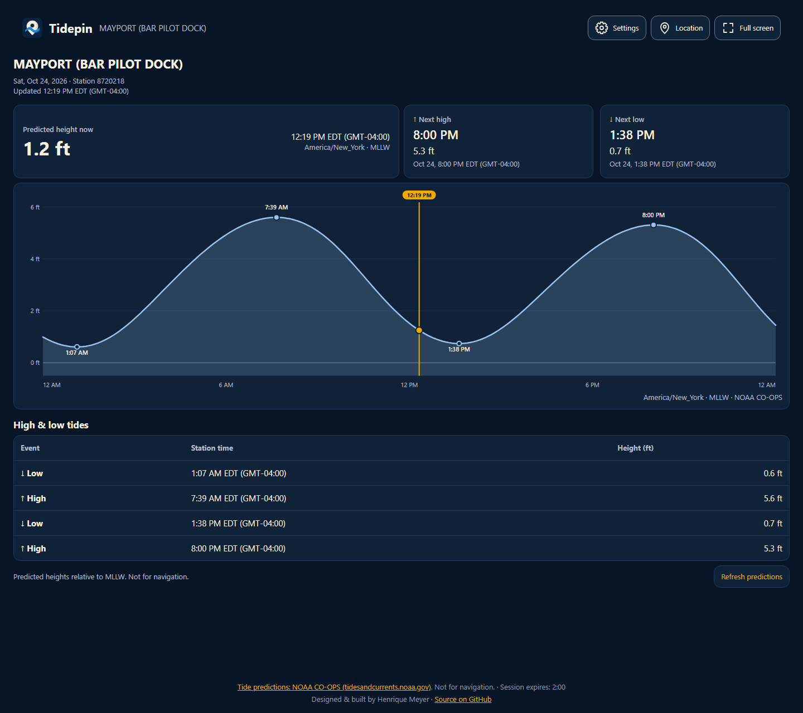
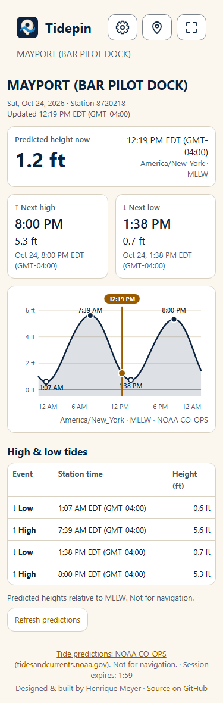

# Tidepin

A browser display for today's tide predictions at a chosen NOAA CO-OPS station. It shows the predicted height now, the next high and low, a daily curve and a chronological event table. The interface follows the [BoltClock demo](https://github.com/henrique-meyer/boltclock), using Tidepin's original logo and system light/dark design tokens.

[Tide predictions: NOAA CO-OPS (tidesandcurrents.noaa.gov)](https://tidesandcurrents.noaa.gov). **Not for navigation.** Heights are predictions relative to Mean Lower Low Water (MLLW), not observed water levels.

Designed & built by Henrique Meyer · [Source on GitHub](https://github.com/henrique-meyer/tidepin)

## Screenshots





Captured locally from public NOAA predictions on 2026-10-24. These images illustrate the interface; their values are not current readings. The narrow image shows the complete scrollable page.

## Use the display

Open the main page and press **Start display** to use a saved station. On a first visit, allow browser location or choose **Set location** to open `/location`. The chosen point resolves to the nearest NOAA prediction station. The picker supports place search, a map click, a draggable pin and **Use current location**. Save returns directly to the display once; an ordinary reload presents Start again.

The station name and identifier identify which predictions are shown. Dates and times use that station's validated IANA time zone, including daylight saving; they do not switch to the device's zone. Harmonic stations use NOAA's six-minute predictions, with gaps left visible. For subordinate stations offering only predicted highs and lows, the demo estimates the curve between consecutive extremes with a half-cosine and labels both the curve and current height as **estimated**. The ocean background uses that same estimated current level. High/low markers, cards and the table always retain NOAA's actual predicted extremes. Estimates never extend beyond available extremes, and are not observations or navigation guidance. Missing predictions and unavailable station zones have clear fallback messages. See the [estimation decision](docs/decisions/0005-subordinate-curve-estimates.md) for limitations.

The top bar offers **Settings**, **Location** and **Full screen** when supported. Settings changes feet/meters and the 12/24-hour clock immediately across cards, axes, table and accessible descriptions. **Reset** restores feet and the 12-hour clock while keeping the location. Full screen is requested only through its button; exiting restores the action buttons.

The visible display refreshes once a minute and when returning to the foreground. Loading, unavailable products, saved predictions and retry waits are shown explicitly. **Refresh predictions** bypasses cache freshness without bypassing NOAA request cooldowns. Background tabs pause requests. The footer counts down **Session expires: H:mm**; expiry stops graph work and returns to Start with **Your session has ended. Press Start display to continue.** Start begins a fresh session with the same station. This is a cooperative demo limit, not a server quota.

The footer combines the linked NOAA credit and **Not for navigation.** in one naturally wrapping paragraph, with the personal/source credit separate. It remains on Start, display and location pages.

## Run locally

Use Node 24 or newer:

```sh
npm ci
cp .env.example .env
npm run dev
```

In PowerShell, use `Copy-Item .env.example .env` for the copy step. Open `http://localhost:5173`. Vite proxies `/api`, `/assets` and `/health` to Fastify on port 8080. If changing `PORT` for development, update the matching Vite proxy target too.

NOAA requires no API key. An optional, deployment-supplied Google Maps key enables the map and place search. Without it, the picker explains the unavailable map and retains browser current-location selection.

### Runtime configuration

| Variable | Default | Meaning |
| --- | --- | --- |
| `PORT` | `8080` | Process port, an integer from 1 to 65535 |
| `GOOGLE_MAPS_API_KEY` | Empty | Browser-restricted key for Maps JavaScript API and Places API (New) |
| `GOOGLE_MAPS_MAP_ID` | `DEMO_MAP_ID` | Optional public map ID for the draggable advanced marker |
| `SESSION_LIMIT_MINUTES` | `120` | Whole-minute display session limit, from 1 through 120 |

The development server script loads `.env`; `npm start` reads the process environment. Keep actual configuration outside tracked files. The Maps key is supplied at runtime rather than embedded in a built bundle, and is visible to visitors by design. Restrict it to the two required APIs and your actual HTTPS website referrers, such as `https://your-domain.example/*`. Authorize a separate local test referrer/key explicitly. Google Maps setup and its billing are separate from free NOAA prediction access.

## Check, build and run a container

```sh
npm run lint
npm run typecheck
npm test
npm run build
npm start
```

After building, open `http://localhost:8080`. `GET /health` returns exactly `{"status":"ok"}` independently of NOAA availability. Unit tests use frozen synthetic NOAA-shaped fixtures and injected clocks/network responses; they do not need live NOAA or a Maps key.

```sh
docker build -t tidepin .
docker run --rm -p 8080:8080 -e SESSION_LIMIT_MINUTES=120 tidepin
```

The two-stage `node:24-slim` image runs as the non-root `node` user. It contains production dependencies, built pages, original assets and the project/upstream license notices. The app is stateless: bounded caches are disposable process memory, with no database or persistent volume.

## How it is built

TypeScript runs on Node 24 with Fastify; Vite builds two plain TypeScript browser pages, with no UI framework. The server resolves stations and local-day windows, retrieves NOAA products through one paced transport, and serves a validated response to the graph. Shared pure functions keep canonical UTC seconds and meters separate from presentation. The SVG curve and HTML event table share the same source data and preferences.

| Path | Responsibility |
| --- | --- |
| `src/server` | Fastify routes, runtime config, station/zone resolution, NOAA clients and shared scheduler |
| `src/client` | Start/display lifecycle, graph, location picker, controls, preferences and session timer |
| `src/shared` | Canonical tide/station types, chart computations, interpolation and station-local dates |
| `test` | Vitest tests and frozen fixtures |
| `assets` | Original brand assets |
| `docs` | System design, data behavior, task history, decisions and screenshots |
| `infra` | Parameterized Bicep and deployment guide |
| `.github/workflows` | Exact-head PR checks and main-branch container deployment |

Only coordinates and station ID are saved for location selection. The separate display-preference record stores only height unit and clock format. The demo never persists or logs addresses, search text or station names. Search text goes directly to Google Places; user-coordinate station lookup uses a POST body. See [system design](docs/system-design.md) for privacy and lifecycle details, and [data sources](docs/data-sources.md) for NOAA endpoints, station zones, cache/backoff and prediction limitations.

## Deploy a new installation

The reference host is Azure Container Apps Consumption: 0.25 vCPU, 0.5 GiB, zero minimum replicas and at most one replica. Cold starts are expected. Scale-to-zero and session limits reduce idle work; neither promises a zero bill.

Follow the [infrastructure guide](infra/README.md) to prepare private parameters, preview/provision resources and configure the GitHub `production` environment. PR checks validate the app, Bicep and a live non-root container without cloud credentials. Each push to `main` publishes a public GHCR image and, once configured, deploys its immutable commit tag using a scoped OIDC identity. DNS and free managed-certificate issuance are separate operator steps. Keep resource names, IDs, domains and keys in private configuration; examples use placeholders only.

Decisions: [hosting](docs/decisions/0001-hosting.md), [stack](docs/decisions/0002-stack.md), [demo sessions](docs/decisions/0003-demo-session.md), [station time zones](docs/decisions/0004-station-time-zones.md), [subordinate curve estimates](docs/decisions/0005-subordinate-curve-estimates.md). The [implementation plan](docs/plan.md) records shipped work and outstanding follow-ups.

## License

Tidepin Demo is source-available for noncommercial use under [PolyForm-Noncommercial-1.0.0](LICENSE). This is not an OSI-approved license. Commercial use requires permission from the author. Browser bundles carry the license URL and exact Required Notice; the runtime image includes the license.

The Tidepin name, logos and artwork are not licensed for reuse. Third-party dependencies and geographic boundary data retain their own terms, including the upstream MIT/ODbL notices described in [third-party notices](docs/third-party-notices.md) and [THIRD-PARTY-NOTICES](THIRD-PARTY-NOTICES). NOAA CO-OPS remains the sole source of tide predictions.
