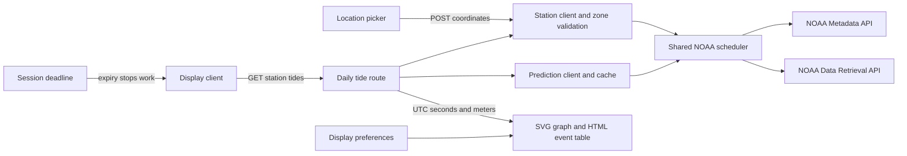

# System design

Tidepin Demo is one stateless Node 24 process serving two browser pages. Fastify owns runtime configuration, station discovery and NOAA prediction retrieval; the browser owns location selection, preferences, the Start/display lifecycle and rendering. The [stack](decisions/0002-stack.md) follows the existing BoltClock conventions.

## Components and data flow

The browser never calls NOAA directly. Maps/place search is a separate, deployment-supplied Google integration, not a tide source.

| Component | Responsibility |
| --- | --- |
| `src/server/app.ts` | Construct Fastify without opening a socket, validate routes, serve pages/assets |
| `src/server/config.ts`, `index.ts` | Validate environment input, start on `0.0.0.0:PORT`, close gracefully on SIGINT/SIGTERM |
| `station-client.ts`, `station-zones.ts` | Resolve the nearest prediction station, cache metadata, validate its geographic IANA zone |
| `noaa-client.ts`, `noaa-scheduler.ts` | Fetch independent curve/event products, normalize/cache them, pace all NOAA traffic |
| `src/shared/tides.ts` | Pure chart segmentation, interpolation, local-day/DST windows and unit/time formatting |
| `src/shared/tide-response.ts` | Typed station/window/product response shared with the browser |
| `display-controller.ts`, `main.ts`, `start-screen.ts` | Start/display state, saved-station startup and lifecycle integration |
| `graph-controller.ts`, `graph-model.ts`, `graph.ts` | Request lifecycle, response validation, geometry, cards/SVG/table and accessibility |
| `location.ts`, `location-settings.ts`, `geolocation.ts` | Map/search/pin selection, browser position and narrowly scoped device storage |
| `controls.ts`, `display-settings.ts`, `session.ts` | Top bar/settings, shared preferences, bounded session and footer time left |
| `ocean-background.ts`, `ocean-level.ts` | Decorative tide-level backdrop from the graph's existing canonical data, with no request or clock |

## HTTP contract and build

| Route | Behavior |
| --- | --- |
| `GET /` | Built display page |
| `GET /location` | Separate built location-picker page |
| `GET /health` | Exactly `{"status":"ok"}`, independent of NOAA or Maps availability |
| `GET /api/config` | Only browser-safe Maps key/map ID and `sessionLimitMinutes`; never `process.env` |
| `POST /api/stations/nearest` | Numeric `{latitude, longitude}` body, at most 1 KiB; resolves a prediction station |
| `GET /api/stations/:id` | Public station metadata for a validated seven-character alphanumeric ID |
| `GET /api/tides/:id` | Station, current local-day UTC window, request instant and independent prediction products |
| `GET /api/tides/:id?refresh=1` | Explicit refresh respecting all upstream pacing/cooldowns |
| `/assets/` | Original assets served separately from the built client |

The tide route resolves the station zone on the server and computes today's start/end using `stationDayWindow`. It rejects invalid IDs (400), unknown stations (404), unavailable zones (422) and metadata/route transport failures (503). Products can fail independently inside a successful response. Clients cannot choose arbitrary prediction ranges, datums or intervals. API responses have `Cache-Control: no-store`; server caches govern upstream freshness. Unrecognized paths return 404.

Vite serves the two HTML entries in development on port 5173, proxying `/api`, `/health` and `/assets` to Fastify on 8080. Production compiles into `dist/server` and `dist/client`; Fastify serves the built pages. `buildApp` supports Fastify injection for HTTP tests without opening a socket.

The two-stage `node:24-slim` image contains only production dependencies, compiled output, original assets and license notices. It runs as the unprivileged `node` user, with no database or persistent volume. Local notes/configuration, tests and infrastructure files stay out of its build context. Browser JavaScript retains the exact project license URL/Required Notice; the runtime retains `LICENSE`, `THIRD-PARTY-NOTICES` and upstream dependency/data notices.

## NOAA transport, caches and station time

Metadata and predictions use one process-wide `noaa-scheduler.ts` queue. It consumes a response body before releasing the queue and leaves at least one second between request starts. Network/timeouts, HTTP failures, malformed JSON, invalid products and NOAA error envelopes apply a shared minimum sixty-second cooldown; longer `Retry-After` instructions win. Each client retains separate bounded caches and caller-owned snapshots. Manual refresh bypasses freshness, not cooldowns. See [data sources](data-sources.md) for exact request/product and saved-data rules.

The station client includes reference and subordinate tide-prediction stations and selects the nearest by great-circle distance. Station ID case and leading zeros are preserved. A server-only geographic lookup uses the station's public coordinates and cross-checks NOAA offset/DST metadata. Missing, ambiguous, conflicting or longitude-only fallback zones are unavailable rather than guessed. The bounded geometry cache is distinct from total process memory; [ADR 0004](decisions/0004-station-time-zones.md) records that tradeoff and upstream attribution.

Canonical times are UTC Unix seconds and heights are finite signed meters relative to MLLW. The supplied IANA zone governs station dates and formatting. A DST day therefore has its actual 23/25-hour duration, and the horizontal axis uses elapsed seconds rather than equal-sized wall-clock hours.

## Start, graph and session lifecycle

A saved station is reused without requesting browser geolocation. A first visit offers current location or the map picker; denied/unavailable positions leave the picker accessible. Browser coordinates resolve to a station before Start is enabled. The Start screen uses the supplied transparent Tidepin PNG with descriptive alt text; lossless removal of fully transparent padding and PNG compression preserve the artwork pixels and alpha channel. The splash follows the reference display's viewport-relative logo, title, spacing and primary-button proportions, with width limits for phones and a visible keyboard focus outline. `DisplayController` protects Start/display state against late permission responses. Returning from a saved picker selection consumes a transient return flag and opens the display once; an ordinary reload shows Start.

`setupDisplaySession()` registers before `setupTideGraph()`. Starting emits `tidepin:display-start` with the selected station and preferences. The graph requests the daily API, then refreshes every sixty seconds while active and visible. Hiding pauses timers and aborts the current request. Returning to the foreground refreshes only if the display is still active. Generation guards discard late results after a station change, stop or abort. Refresh feedback stays in a persistent, responsive space beside or above its button, preserving the rendered display footprint through loading, saved-result and retry-cooldown states. Only an actual in-flight request sets the button busy and uses a progress cursor; cooldown disables activation without reporting continued loading. A failed app request retains only previously covered data for the same local day; yesterday is never relabelled as today.

`session.ts` starts one in-memory deadline per display session using the 1–120-minute runtime setting (default 120). The footer shows `Session expires: H:mm` while active. Expiry emits `tidepin:session-ended` once: graph timers/data clear, pending requests abort, and the shell returns to Start with “Your session has ended. Press Start display to continue.” A capture-phase visibility check expires a sleeping tab synchronously before a graph foreground handler can run. Delayed callbacks, late configuration and backward clock changes do not extend the session. Configuration failure keeps a bounded 120-minute fallback. There is no timer persistence or keepalive request. [ADR 0003](decisions/0003-demo-session.md) explains why this cooperative client behavior is not a server quota.

`mountTideGraph` exposes `start`, `setPreferences`, `refresh`, `stop` and `destroy`; `setupTideGraph` binds lifecycle events. Optional `onChartData` and `onStation` callbacks let presentation layers reuse canonical points/current height or station identity without another data request. Unavailable/stopped chart data is reported as null. The graph itself does not require a background renderer.

## Chart, controls and accessibility

Harmonic stations use interpolation only across adjacent NOAA samples at most six minutes apart. Their SVG segments stop at gaps. Subordinate stations explicitly use `estimatedExtremes`: the same pure chart builder evaluates a half-cosine between consecutive predicted extremes, retaining exact extrema and covered chart boundaries. The high/low request's 24-hour padding supplies brackets around the day; missing brackets are never extrapolated. The current height is evaluated at its exact instant, and the graph callback passes the same estimate to the ocean. The curve caption, current-height heading and accessible description label it as estimated. This source is not a fallback for harmonic request failures. [ADR 0005](decisions/0005-subordinate-curve-estimates.md) records the numerical model and limitations.

The now dot needs valid interpolation on today's covered chart. Next high/low cards and chart markers always come from NOAA's separate event product, never inferred extrema. Loading, no-predictions, insufficient-extrema, partial/full failure, saved-data and retry-wait states have explicit text. The picker retains the nearest subordinate station and explains estimated-curve handling rather than replacing it with a more distant station. A station with no available predictions can still be selected; the graph shows a clear empty/error state with retry, without fabricating a curve.

The SVG has an accessible description, marker titles, station-zone/datum context and a real chronological HTML table. Feet/meters applies to every shown and accessible height: current, next events, axis, labels and table. Display-only conversion/rounding never changes canonical meters. Station-local time includes zone/offset context; the 12/24-hour preference applies consistently.

The source-style top bar contains Settings, Location and user-requested Full screen. Its action buttons hide during full screen and return on exit; unsupported full screen is hidden and rejection is harmless. The Start screen hides the toolbar. Settings uses native modal focus/Escape handling, applies changes immediately and resets only preferences, retaining location.

`display-settings.ts` owns the typed `{heightUnit: 'ft' | 'm', clockFormat: '12h' | '24h'}` record. Defaults are feet and 12-hour time. Returned snapshots are independent, malformed input falls back safely, unknown fields are not written, and cross-tab changes update subscribers. Blocked device storage leaves preferences usable in memory. `tidepin:preferences-changed` redraws the graph without starting a new session or request.

System light/dark appearance follows `prefers-color-scheme` immediately, without a stored theme setting. CSS properties carry the source Tidepin color, typography, spacing, radius and motion tokens. Text uses system fonts and rem sizes. More-contrast promotes secondary text; reduced-motion disables spinner motion. There is no audio or weather service.

`mountOceanBackground(root)` provides an isolated, decorative water body behind the content, returning `update(data)` and `destroy()`. The main page mounts it on the body and connects `setupTideGraph({ onChartData })`, preserving the station-name callback and session setup order. The graph passes its existing `buildChartData` result on the same refresh cadence: only `chartPoints` and its already interpolated `current` height are consumed, including the explicitly labelled subordinate estimate. No request, clock, location state or continuous animation loop is added. Relative height within that chart window maps from a low surface at 78% of viewport height to a high surface at 24%, clamped at both ends. Missing current data or a flat/unusable range uses an explicitly neutral, faint tint without a visible tide surface. Splash, initial loading, full failure and session end are neutral. Covered saved predictions remain eligible when the graph has a valid current interpolation; missing samples or missing extreme brackets remain neutral where no current height can be established.

The water uses very faint theme-token color mixes, a soft surface line, no interactive elements and `aria-hidden`. Its host establishes a stacking context; the fixed layer stays behind content without intercepting input, including in full screen and on mobile. A finite transform transition uses the existing standard motion token to smooth each changed level; identical updates do not write styles. Reduced motion disables that transition, while increased contrast and forced colors hide the decorative layer. The graph lifecycle owns mounting and disposal.

For an active tide with normal motion, a single six-pixel SVG strip replaces the straight surface stroke with a tiny rolling line, using the same color and one-pixel stroke. Its duplicated geometry has only 1.5 pixels of vertical amplitude; a 36-second CSS transform moves the entire strip by half its width and loops seamlessly. Paths stay unchanged and the water body's level/fill do not animate continuously. No request, timer or per-frame JavaScript is added. One `visibilitychange` listener pauses the CSS animation while hidden and is removed on `destroy()`. Neutral/stopped states remove waves; reduced motion retains the original static surface. Increased contrast and forced colors still hide the whole decorative layer.

The footer's stable `footer-source` paragraph combines the NOAA link and “Not for navigation.” with natural wrapping. Personal/source credit stays in `footer-credit`, and the picker retains its privacy note. Only the designer's name links to the personal site, using the existing footer-link appearance and a new tab with `noopener noreferrer`. External links use `rel="noopener"`. A flexible main row keeps the footer below content rather than overlaying the chart.

## State and privacy

Location selection stores exactly `{latitude, longitude, stationId}` in `tidepin.location`. Station names stay in memory and are reloaded from NOAA. Display preferences use the separate `tidepin.display` record; the picker return marker is transient session storage. No addresses, place queries or timer state are persisted. Storage failure permits the current Start selection in memory, while picker Save explains why it cannot persist before leaving.

Place search uses Google Places API (New), debouncing and session tokens. Query text/suggestions stay in page memory and clear after selection or exit; text goes directly to Google, never through the app. A generation guard rejects stale search/station responses. Maps configuration is browser-safe runtime data; actual key restrictions and private deployment settings stay outside the repository. Missing configuration shows a readable fallback and keeps current-location selection available, without claiming live Maps acceptance.

User coordinates go to station discovery only in a POST body. Automatic request logging is disabled. NOAA metadata/zone lookup uses stations' public coordinates, and server caches hold no user-location history. There is no analytics or server-side place geocoding in this implementation.

## Hosting, delivery and verification

Parameterized Bicep describes Container Apps Consumption, capped Log Analytics, optional budget and scoped GitHub OIDC identity, plus a shared resource dashboard. The fixed app allocation is 0.25 vCPU/0.5 GiB, with zero-to-one replicas and HTTPS ingress. Startup/readiness/liveness probes use process health, not tide freshness. The deploy identity reads the group and modifies only its container app; infrastructure provisioning needs separate permissions. Verified hostname/certificate parameters preserve the binding, while issuance remains a separate operator step.

PR CI checks the exact head: lint, TypeScript, Vitest, production build, Bicep/example compilation, Docker build and live health/non-root UID. Tests inject clocks/network responses and cover canonical data, DST, HTTP errors, scheduler backoff, lifecycle cancellation and preferences without cloud credentials. UI acceptance uses the real running page separately; fixture tests alone do not prove a live Google map or deployment.

Every push to `main` publishes an immutable GHCR commit tag and, when production configuration exists, uses OIDC to roll out the existing app. Rollouts serialize, wake scale-to-zero revisions, require revision health and the exact process-health JSON, and mask environment values in public logs. Bicep applies remain separate and must preserve the latest image and hostname binding. The [infrastructure guide](../infra/README.md) covers the operator procedure; real environment values and deployment evidence belong outside this public repository.
